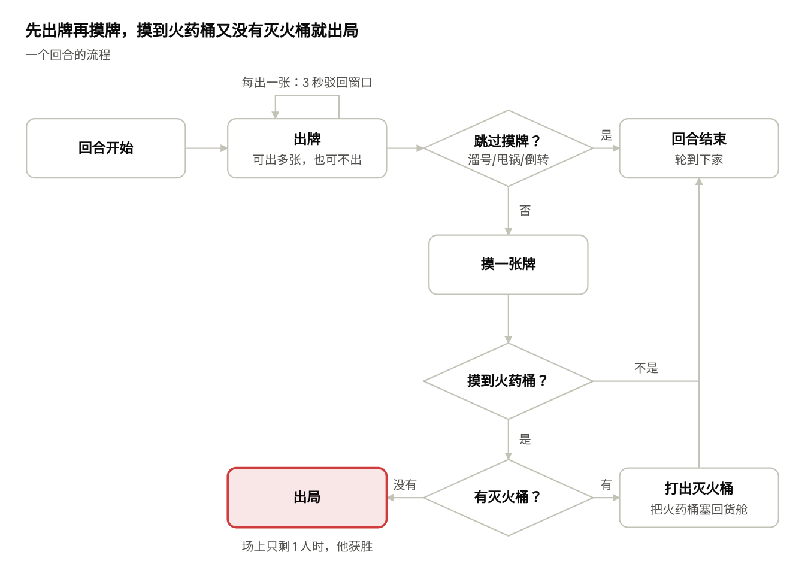
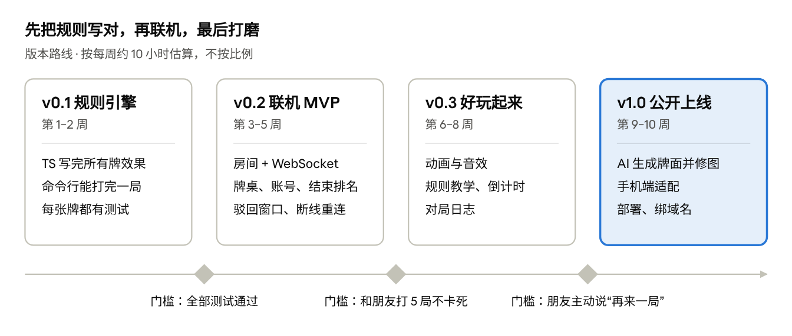

# 卡牌派对游戏《火药桶》产品需求文档（PRD）

2026-11-13 · cianlien

## 产品概述

《火药桶》（暂定名）是一款 2–5 人网页联机的派对卡牌游戏：海盗们轮流从货舱里摸牌，摸到火药桶又没有灭火桶就出局，最后活着的人赢。

- **玩法来源**：借鉴《炸弹猫》的“摸牌赌运气 + 功能牌坑人”；题材、牌名、美术全部原创
- **平台**：浏览器，桌面和手机都能玩；房主发一个房间链接，朋友点开就能进，不用注册
- **单人也能玩**：没有朋友在线时，可以直接和电脑打一局
- **一局时长**：5–15 分钟
- **和炸弹猫的区别**：加一张原创牌“倒转航向”（反转出牌顺序），并且线上独有“出牌倒计时”和“驳回窗口”，节奏更紧
- **为什么做这个**：规则简单、规模小，几周就能做出能和朋友玩的版本；又正好练到后端最核心的东西——实时通信和状态管理

## 规则与回合流程

每回合先随意出牌，最后必须摸一张；摸牌越往后越危险，紧张感就来自这里。

开局配置：

1. 先把火药桶和灭火桶从牌堆里挑出来。
2. 每人发 1 张灭火桶 + 7 张其他牌。
3. 把“玩家数 − 1”张火药桶和剩下的灭火桶洗回货舱。
4. 随机决定先手，按座位顺序轮流。

火药桶比人数少一张，所以一定会炸到只剩一个人。

## 卡牌设计

一副牌共 55 张底牌，再按人数放入火药桶；数量是第一版的初始值，试玩后再调。

| 牌 | 数量 | 效果 |
| --- | --- | --- |
| 火药桶 | 玩家数 − 1 | 摸到必须立刻打出灭火桶，否则出局 |
| 灭火桶 | 6 | 拆掉火药桶，并把它秘密放回货舱任意位置 |
| 溜号 | 4 | 结束本回合，不摸牌 |
| 甩锅 | 4 | 结束本回合不摸牌，下家连续进行 2 个回合（可叠加） |
| 望远镜 | 5 | 偷看货舱顶上 3 张，只有自己能看到 |
| 翻货舱 | 4 | 打乱货舱 |
| 讨要 | 4 | 指定一人，对方自己挑一张牌给你 |
| 驳回 | 5 | 抵消别人刚出的牌（火药桶和灭火桶除外），驳回也能被驳回 |
| 倒转航向（原创） | 3 | 出牌顺序反过来，并结束本回合不摸牌 |
| 船员牌 × 5 种 | 各 4 | 单张没效果；2 张相同抽别人 1 张随机牌，3 张相同点名要一张指定的牌 |

船员牌建议做成 5 个有个性的角色（如独眼厨师、晕船的航海士），它们是这个游戏幽默感的主要来源。

## 功能需求

MVP 有 7 个 P0 功能：房间、对局规则、驳回窗口、牌桌界面、断线重连、账号、结束排名。

| 功能 | 需求要点 | 优先级 |
| --- | --- | --- |
| 房间 | 创建房间生成 6 位房间号和链接；登录或以游客身份加入；房主点“开始” | P0 MVP 必做 |
| 对局规则 | 服务器执行全部规则：发牌、出牌、摸牌、火药桶、出局、胜负 | P0 MVP 必做 |
| 驳回窗口 | 每次出牌后给所有人 3 秒驳回，有人驳回就重新计时 | P0 MVP 必做 |
| 牌桌界面 | 手牌、货舱剩余张数、当前行动者、弃牌堆、其他人手牌数 | P0 MVP 必做 |
| 断线重连 | 刷新或断网后 60 秒内回来，恢复手牌和座位 | P0 MVP 必做 |
| 账号 | 邮箱注册登录，设置昵称和头像；未登录可用游客身份玩，但不计战绩 | P0 MVP 必做 |
| 结束排名 | 按出局顺序排名，最后活下来的第 1；结算页显示名次和每人撑过的回合数，可一键再来一局 | P0 MVP 必做 |
| 历史战绩 | 个人页显示场次、胜场、平均名次 | P1 上线前要有 |
| 回合倒计时 | 每回合 30 秒，超时自动摸牌，防止有人挂机 | P1 上线前要有 |
| 对局日志 | 侧栏实时显示“谁对谁出了什么牌” | P1 上线前要有 |
| 动画与音效 | 出牌飞入、摸牌翻开、火药桶爆炸的特写 | P1 上线前要有 |
| 规则教学 | 第一次进入时 5 步图文引导，牌上长按看说明 | P1 上线前要有 |
| 电脑玩家 | 单人模式：一个人对 1–4 个电脑；大厅里房主也能加电脑凑桌；人机局不记战绩 | 已实现 |
| 房间内聊天 | 快捷表情和短句（“你完了”“救命”） | P2 有空再做 |
| 自定义规则 | 房主可调火药桶数量、是否启用倒转航向 | P2 有空再做 |

## 技术方案

前后端都用 TypeScript（前端 React、后端 Node）：规则全部放在服务器上跑，客户端只负责显示和发送操作。选型的细节和取舍见 [技术架构与选型](architecture.md)。

| 模块 | 选型 | 说明 |
| --- | --- | --- |
| 前端 | React + Vite + TypeScript | 牌桌界面；动画用 CSS 或 Framer Motion |
| 后端 | Node + Socket.IO | 自带房间、心跳和断线重连，少写很多底层代码 |
| 房间状态 | 存内存 | 对局中的房间放内存，房间没人了就删掉 |
| 消息格式 | JSON，客户端发“操作”，服务器广播“事件” | 例如 `{"type":"play","cards":[12]}` |
| 部署 | 一台小云服务器 + Docker Compose + Caddy，前后端同机 | 2 核 2 GB 足够；原因见技术架构文档的“部署与运维” |
| 数据库 | PostgreSQL + Drizzle | 存账号、每局结果和名次；和后端放在同一台服务器 |
| 登录 | 邮箱 + 密码，session 存数据库 | 密码加盐哈希（bcrypt），WebSocket 连接时校验登录态 |

三个关键设计：

1. **服务器权威**：货舱顺序和别人的手牌永远不发给客户端。服务器给每个人单独生成“他能看到的视图”，打开开发者工具也作不了弊。
2. **驳回窗口用状态机**：出牌后进入“等待驳回”状态并开 3 秒计时器；每来一张驳回就重新计时；到时后数驳回张数，奇数则取消，偶数则生效。这是整个项目最难的部分，建议先写单元测试。
3. **规则引擎和网络分开**：规则写成纯函数（输入当前状态和操作，输出新状态和事件），不碰 WebSocket。这样不联网也能测，以后加电脑玩家也简单。牌的定义和类型放在共享包里，前后端共用一份。

## 版本规划

按每周约 10 小时估算，第 5 周就能和朋友在线上开一局，第 10 周公开上线。

先写规则引擎不带界面，是为了把最难的连锁规则在最便宜的阶段写对。

## 风险、版权注意与已定事项

最大的风险是驳回窗口和断线带来的状态错乱；其次是做得太像原版。

| 风险 | 后果 | 应对 |
| --- | --- | --- |
| 驳回、甩锅叠加等连锁规则写错 | 牌局卡死或结算错误 | 规则引擎用纯函数 + 单元测试覆盖每张牌 |
| 断线、刷新 | 玩家丢牌、一局作废 | 用玩家 token 重连，服务器保留座位 60 秒 |
| 作弊 | 偷看货舱、伪造出牌 | 服务器权威 + 校验每个操作是否合法 |
| 侵权 | 公开发布后被投诉下架 | 见下方版权注意 |

**版权注意**：游戏机制本身一般不受版权保护，但名字、商标、卡牌美术和牌面文字受保护。所以不要用“炸弹猫”这个名字，不要用猫咪题材，不要照抄原版的牌名和画风。只给朋友玩问题不大；要商业化的话，先咨询一下律师。牌面用 AI 生成后人工修：提示词里不写原版游戏名和在世画师的名字；固定一套风格描述和配色，保证整副牌画风统一；牌名和文字后期自己排版，不让 AI 画字。

已定事项：

- [x] 题材：海盗火药桶
- [x] 后端：Node（和前端共用一套类型）
- [x] 账号和战绩：要有账号和结束排名
- [x] 牌面美术：AI 生成后人工修
