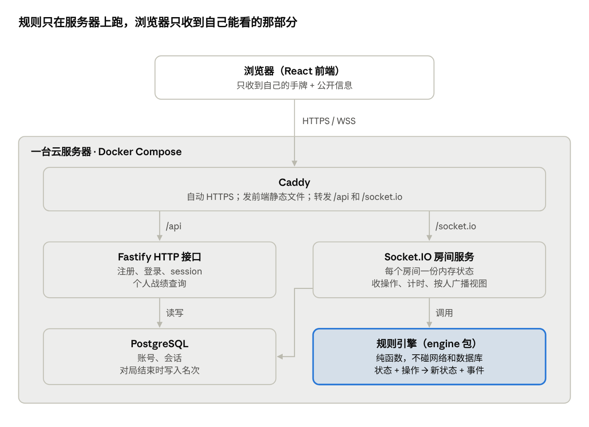
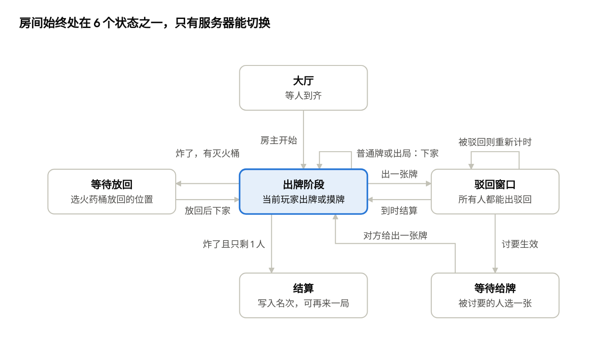

# 《火药桶》技术架构与选型

2026-11-13 · cianlien

## 结论速览

全栈 TypeScript：前端 React，游戏服务 Node + Socket.IO，数据存 PostgreSQL，全部部署在一台云服务器上。规则引擎是独立的纯 TS 包，前后端共用一份牌的定义。

| 层 | 选型 | 为什么 |
| --- | --- | --- |
| 前端 | React + Vite + TypeScript | 你最熟的技术，开发最快 |
| 前端状态 | Zustand | 接服务器推来的牌桌状态很顺手，比 Redux 轻 |
| 动画 | Motion（原 Framer Motion） | 出牌、翻牌、爆炸这类布局动画写起来简单 |
| 实时通信 | Socket.IO | 自带房间、心跳、自动重连 |
| HTTP 接口 | Fastify | 注册、登录、战绩查询；TS 支持好，和 Socket.IO 共用一个端口 |
| 规则引擎 | 纯 TypeScript 包 | 输入状态 + 操作，输出新状态 + 事件，不联网也能测 |
| 消息校验 | Zod | 客户端发来的每条消息先校验再处理 |
| 数据库 | PostgreSQL + Drizzle | 存账号、会话、对局和排名 |
| 登录 | 邮箱 + 密码，session cookie | 比 JWT 简单，可以随时让登录失效 |
| 测试 | Vitest | 和 Vite 一套配置，规则引擎靠它保证正确 |
| 部署 | 一台云服务器 + Docker Compose + Caddy | 前端、后端、数据库都在一起，小规模最省事 |
| 仓库与任务 | pnpm workspaces + Turborepo | 按依赖顺序跑构建、测试、类型检查，没改过的包直接用缓存 |

和 PRD 最初版本的一处不同：前端不再放 Vercel，而是和后端放同一台服务器，原因见“部署与运维”。

## 整体架构

浏览器只和一个域名打交道，背后是一台服务器上的四个部件；牌局的真相只存在于房间服务的内存里。



对局中只有 Socket.IO 在忙，数据库每局只在结束时写一次。

## 仓库结构

一个仓库用 pnpm workspaces + Turborepo 管理两个应用和两个共享包，改一处牌的定义，前后端同时生效。

```text
huoyaotong/
├─ apps/
│  ├─ web/          # React 前端：大厅、牌桌、结算页、登录、战绩
│  └─ server/       # Fastify + Socket.IO：登录接口、房间、计时器、写库
├─ packages/
│  ├─ engine/       # 规则引擎：纯函数，不依赖网络和数据库
│  └─ shared/       # 牌的定义、消息类型、Zod 校验
├─ deploy/          # Caddy 配置
├─ scripts/         # 数据库备份脚本
├─ Dockerfile
├─ docker-compose.yml
├─ pnpm-workspace.yaml
└─ turbo.json       # 任务编排：build / test / typecheck / dev
```

依赖只能单向：apps 可以用 packages，engine 只用 shared，shared 不依赖任何人。这样规则引擎永远能单独测试。

## 选型对比

取舍的标准只有一条：一个人业余做，少写底层代码、少学新框架，把时间花在规则和手感上。

| 问题 | 备选 | 选择 | 取舍 |
| --- | --- | --- | --- |
| 实时通信 | 原生 ws / Socket.IO / Colyseus | Socket.IO | ws 要自己写房间和重连；Colyseus 是游戏专用框架，功能强但要先学它的状态同步模型 |
| HTTP 框架 | Express / Fastify / Hono | Fastify | Express 类型支持弱；Hono 更偏边缘函数；Fastify 在长期运行的服务器上最稳 |
| 数据库 | SQLite / PostgreSQL / MongoDB | PostgreSQL | SQLite 起步最简单但并发写弱；排名和战绩需要统计查询，关系型更合适 |
| ORM | Prisma / Drizzle | Drizzle | 纯 TypeScript，安装和生成都不用额外下载引擎文件，写法贴近 SQL；Prisma 教程更多，但生成客户端要联网下载引擎。数据库访问收在 Store 接口后面，以后要换只改一个文件 |
| 登录状态 | JWT / session cookie | session cookie | JWT 发出去就收不回；session 存库里，要踢人下线删一行即可 |
| 密码哈希 | bcrypt / argon2 | bcrypt | 两者都安全；bcrypt 的 npm 包安装问题少 |

如果以后想用它练 Go：规则引擎是纯函数，可以照着 TS 版和测试用例用 Go 重写一遍，水平提升很明显。

## 对局核心设计

每个房间是一个状态机：客户端只能发“操作”，服务器用规则引擎判断是否合法、算出新状态，再给每个人发他能看到的视图。



**消息协议**（类型定义在 shared 包，客户端发来的用 Zod 校验）：

```ts
// 客户端 → 服务器：只有“操作”
type Action =
  | { type: 'play'; cardIds: number[]; targetSeat?: number; namedCard?: CardKind }
  | { type: 'nope'; cardId: number }
  | { type: 'draw' }
  | { type: 'giveCard'; cardId: number }      // 被讨要时
  | { type: 'placeKeg'; position: number };   // 灭火后放回火药桶

// 服务器 → 客户端：每人一份视图 + 公开事件
type PlayerView = {
  phase: Phase;
  myHand: Card[];
  deckCount: number;                  // 只给张数，不给顺序
  players: { seat: number; nickname: string; handCount: number; alive: boolean }[];
  currentSeat: number;
  deadline: number;                   // 当前计时器到期时间
  peek?: Card[];                      // 只有用了望远镜的人有
};
```

上面是设计时的草图；实际的完整类型以 `packages/shared/src/protocol.ts` 为准（望远镜看到的牌最后是通过只发给本人的事件下发的）。

几个关键点：

1. **驳回窗口**：出牌后先不生效，进入驳回窗口并开 3 秒计时器。每来一张驳回就重新计时；到时后数驳回的张数，奇数取消、偶数生效。计时器只在服务器上，客户端的倒计时只是显示。
2. **并发**：同一房间的操作按到达顺序排队一个一个处理，两个人同时驳回也不会乱。Node 是单线程，只要处理函数里不写 await 就天然有序。
3. **断线重连**：加入房间时发一个座位 token；断线后座位保留 60 秒，带 token 重连就把最新视图重发一遍。不靠 Socket.IO 的自动恢复，因为刷新页面会是一个全新的连接。
4. **防作弊**：货舱顺序和别人的手牌永远不出服务器；每个操作都检查“是不是轮到你、这张牌在不在你手里”。
5. **洗牌**：用 Node 自带的 `crypto.randomInt` 做 Fisher–Yates 洗牌，不用 `Math.random`。

## 数据模型

数据库只存四张表：用户、会话、对局、对局参与者；对局进行中的牌局只在内存里，结束时才写一次库。

| 表 | 字段 | 说明 |
| --- | --- | --- |
| users | id、email（唯一）、password_hash、nickname、avatar、created_at | 密码只存 bcrypt 哈希 |
| sessions | id、user_id、expires_at | id 是 cookie 里 token 的 SHA-256，数据库泄露也拿不到能用的登录凭证 |
| matches | id、started_at、ended_at、player_count | 一局一行 |
| match_players | match_id、seat（两者合起来是主键）、user_id、nickname、rank、turns_survived | user_id 为空表示游客，不计战绩；rank 1 = 最后活着的人 |

表结构定义在 `apps/server/src/db/schema.ts`，迁移 SQL 在 `apps/server/drizzle/`，服务端启动时自动执行。

排名的算法：第一个出局的是最后一名，依次往前，最后活着的是第 1。个人页的场次、胜场、平均名次都从 match_players 实时统计，不单独存。

## 部署与运维

一台 2 核 2 GB 的云服务器跑 Docker Compose 里的三个容器：Caddy、游戏服务、PostgreSQL。

- **同一个域名**：Caddy 直接发前端静态文件，`/api` 和 `/socket.io` 转给游戏服务。前后端同源，cookie 登录不用处理跨域。
- **HTTPS**：Caddy 自动申请和续期证书，WebSocket 也走 wss。
- **备份**：每天凌晨用 `pg_dump` 导出数据库（scripts/backup.sh），本地保留 7 天；同步到对象存储还需要自己配。
- **发布**：GitHub Actions 负责跑测试和构建；发布是在服务器上执行 git pull 和 docker compose up -d --build，镜像用 turbo prune 只打包用得到的包。发布时对局中的房间会断开，所以挑没人玩的时候发。
- **监控**：服务器日志用 Fastify 自带的 pino；再加一个免费的在线状态检测，挂了发邮件提醒。

为什么不用 Vercel：如果玩家主要在中国大陆，Vercel 的访问速度和可用性都不稳定。大陆服务器绑域名需要 ICP 备案，要等一段时间；香港服务器不用备案，延迟稍高一点，但回合制卡牌对延迟不敏感。建议先用香港服务器上线。

## 风险与以后的扩展

单台服务器、单个进程是有意的选择：朋友圈规模（几十个房间同时开）完全够用，等真有压力了再扩。

| 场景 | 现在的做法 | 以后怎么扩 |
| --- | --- | --- |
| 服务重启丢对局 | 接受，发布挑没人玩的时候 | 房间状态定时快照到 Redis，重启后恢复 |
| 同时在线超出单机 | 不处理 | 多进程 + Socket.IO 的 Redis 适配器，同一房间固定在同一进程 |
| 有人刷注册、暴力试密码 | 注册和登录接口限流 | 加邮箱验证码 |
| 手机网络频繁断线 | 座位保留 60 秒 | 断线期间自动托管（超时只摸牌） |
| 规则改动引起旧 bug | 规则引擎单元测试 | 记录真实对局的操作序列，用来做回放测试 |
